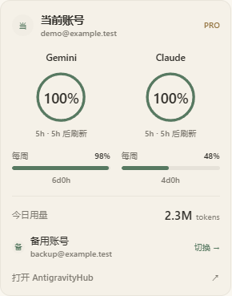
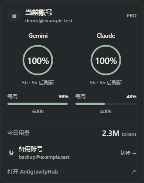

# AntigravityHub

Windows 上的 Antigravity 辅助工具：把账号、配额、用量看板、客户端状态栏，以及 HansWin 的汉化和窗口设置放进同一个 Hub。

当前源码版本：**1.3.3**。客户端增强目前仅适配 **Antigravity 2.22.0 Windows x64**。

[下载 Windows 版](https://github.com/Cainite07/AntigravityHub/releases/latest) · [版本说明](docs/RELEASE_NOTES_1.3.3.md) · [MIT 许可证](LICENSE)

## 快速开始

1. 从 [Releases](https://github.com/Cainite07/AntigravityHub/releases/latest) 下载 `AntigravityHub-1.3.3-Windows-x64.zip`。
2. 完整解压压缩包，打开其中的 `AntigravityHub.exe`。首次启动默认进入托盘，可按 **Alt + A** 或再次打开程序显示窗口。
3. 在设置页按需开启界面汉化、思维链汉化或自定义窗口尺寸。两种汉化分别控制，默认关闭。
4. 客户端增强组件已包含在发布包内；修改需要重启的设置后，可使用提醒中的按钮重启 Antigravity。

需要 Windows x64 和 Microsoft Edge WebView2 Runtime。运行发布包无需另装 .NET、Node.js 或 Python。授权登录、令牌刷新所需的本地配置见下方「OAuth 本地配置」。

## 状态栏预览

状态栏依次显示头像、5 小时额度圆环、当前会话平均输出速率和今日 token 用量。展开面板采用 85% 比例和清晰字号，跟随客户端浅色或深色外观。

| 浅色 | 深色 |
| --- | --- |
|  |  |

预览使用合成账号与演示数据。

## 功能

- 账号管理：读取当前客户端登录、导入账号、切换账号、查看订阅和配额。
- 用量看板：本地会话用量、每日明细、热力图、模型画像和参考费用估值。
- Hub 外观：纸色 / 墨色主题、系统主题、原生托盘和全局快捷键。
- 界面汉化：在设置页最上方显著展示，**默认关闭**，由用户主动开启；使用本地词典和已核验的界面补丁。
- 思维链汉化：独立开关，默认关闭，可与界面汉化分别选择。
- 客户端窗口：自定义宽高，开启后在恢复 / 打开窗口时应用；尺寸以逻辑像素（DIP）表示，自动限制到当前显示器可用区域。
- 客户端状态栏：头像、当前模型的 5 小时剩余额度圆环、当前会话输出速率、今日累计 token 用量。账号面板用两个大圆环展示 5 小时额度，周额度用细进度条展示，支持切换备用账号和打开 Hub。

界面汉化只处理客户端文字：分类标题和说明、按钮、工具提示、表单占位文字、空状态。插件名称与介绍、技能与规则内容、代码和用户输入保留原文。固定界面文字使用本地词典；部分客户端模型公告等动态提示会调用腾讯 / 有道翻译服务，未命中的内容可能保留原文。思维链汉化使用独立、默认关闭的开关；用户开启后，客户端展示的思考片段会发送给腾讯翻译，失败时尝试有道。它只翻译客户端已经展示的内容。

会话输出速率从当前客户端的本地请求元数据计算：有效正文输出 token 总数除以对应的流式生成总时长，不计首 token 等待和工具执行时间。约每 3 秒刷新，显示已完成请求的会话加权平均值。没有有效记录时显示 `—`；切换会话时清空旧值。不需要安装其他插件，不向外部服务发送会话内容。若某模型未区分正文和思考 token，提示会注明包含思考输出。计算代码参考 Antigrative Dashboard，见 [第三方声明](THIRD-PARTY-NOTICES.md)。

## 使用设置

下载完整 Windows 发布包后打开 Hub。汉化、窗口与状态栏组件已经包含在包内，Hub 会自动校验并接入已支持的客户端，不需要手动安装组件或另装 Node.js / Python。首次启动默认常驻托盘，通过桌面入口或 Alt + A 打开窗口。

进入「设置」即可分别开启界面汉化、思维链汉化，或填写自定义窗口尺寸。关闭设置窗口即保存；改动任一汉化开关后，退出设置会显示重启提醒，可点击旁边的小按钮重启 Antigravity，也可以稍后重启。

界面汉化、思维链汉化与自定义尺寸默认关闭。窗口宽高初始值为原版 2.22.0 的 **1400×900** 逻辑像素，不会默认锁定窗口。宽度范围为 640–7680，高度范围为 480–4320，启用后按显示器可用空间限制。关闭自定义尺寸停止后续重设。

首次使用默认开启「关闭时最小化到托盘」和「启动时最小化到托盘」。已有用户修改过的托盘选项与启用的自定义尺寸保留。

如果客户端正在运行，Hub 会准备候选并等它正常退出后自动应用，不会强制结束任务。未知版本不会被修改。正常就绪时设置页不显示维护信息；只有等待退出或接入失败时显示简短状态。

## 环境与构建

- Windows x64。
- .NET 10 SDK（构建）；自包含发布包内置 .NET 运行时。
- Microsoft Edge WebView2 Runtime。
- 完整发布包自带隔离运行组件，不依赖用户安装的 Node.js 或 Python。

```powershell
dotnet build src/AntigravityHub -c Release
./Build-Release.ps1
```

`Build-Release.ps1` 生成完整、自包含的 Windows x64 发布目录：依赖预装在包内，固定版本 Node.js 与 Python 官方运行包经 SHA-256 校验后打包，并保留许可证。首次构建需要联网下载这些构建依赖；用户运行发布包不需要这些开发工具或再次下载它们。单独使用 `dotnet publish` 只构建 Hub，不构成完整发布包。

只运行 Hub 账号与用量功能不需要安装客户端补丁。

前端 CSS 已提交。修改工具类后重新生成：

```powershell
cd src/AntigravityHub/ui-build
npm ci
npm run build
```

## 客户端补丁与原版底包

客户端增强从经过 SHA-256 核验的原版 2.22.0 `app.asar` 组合构建，保留无关文件和外置依赖。仓库不分发 Antigravity 原版程序、ASAR、用户记录或历史安装备份。

首次打开时，Hub 自动从当前未经修改的 2.22.0 客户端缓存原版底包。若客户端已经打过旧补丁，需要自己提供同版本原版包：

```powershell
cd client/maintenance/tools
npm ci --ignore-scripts
node seed-base.cjs "C:\path\to\original\app.asar"
```

相邻的 `app.asar.unpacked` 必须来自同一原版包。原版 ASAR 的已审核 SHA-256：

```text
259c83ffa266088dda6ede520a601bbf06cc5c34985cdf56c5d68549c98dbb0e
```

构建和正式发布时，将本地底包目录（不提交 Git）放到发布包的 `client/release-2.22.0/base/`，或让首次打开自行缓存。不能拿未知版本或修改过的包替代。

客户端运行期间只准备候选并等待自行退出；不会强制结束客户端任务。备份与维护状态写入 `%USERPROFILE%\.antigravity_hub\client_maintenance`。若宿主不允许独立后台维护进程，在退出客户端后重新打开 Hub 即可完成。

客户端升级后可能不再兼容，维护器会拒绝未知版本。不要绕过版本与文件校验。回退方法见 [客户端增强说明](docs/CLIENT_ENHANCEMENTS.md)。

## OAuth 本地配置

公开源码不包含 OAuth 客户端 ID / secret。本机试用沿用已有配置，配置存入用户目录的 DPAPI 加密 `oauth_client.dat`，不进入项目目录或发布包。Google 授权、访问令牌刷新等路径需要与你的客户端 / 服务相匹配的 OAuth 配置。不能假定任意新建 Google OAuth 客户端都能访问 Antigravity 内部接口。

在自己的 Windows 用户环境中设置 `ANTIGRAVITY_OAUTH_CLIENT_ID` 和 `ANTIGRAVITY_OAUTH_CLIENT_SECRET` 后，重新打开 Hub。值只保存在本机环境中，不应写入源代码或提交 Git。README 不提供真实凭据。

没有配置时仍可查看本地用量；读取已有、有效的客户端令牌不依赖新建授权。需要刷新或新授权时会报告配置缺失。账号切换、订阅和配额仍受客户端接口与权限影响。

## 本地数据

账号、DPAPI 加密的令牌、用量数据库和设置位于 `%USERPROFILE%\.antigravity_hub`。客户端登录仍由 Antigravity 自己管理。用量页面的金额为参考估值，不能作为实际订阅账单。

浏览器演示只使用 `preview_data.json` 中的合成数据。发布前不要加入自己的账号文件、真实用量、运行日志、截图中的个人资料或历史备份。

## 验证

```powershell
./Test-AntigravityHub.ps1
# 可指定未加入 PATH 的 .NET 10 SDK
./Test-AntigravityHub.ps1 -DotnetPath "C:\path\to\dotnet.exe"
```

隔离测试覆盖账号持久化、恢复、OAuth 回调、配额未知值、统计聚合、原生控件布局、前端状态，以及新增设置、窗口范围和汉化关闭路径。`tests/client-settings.cjs` 的组合补丁检查需要本地原版底包及维护器依赖。

带 `--live-*` 和 `--migration-replay` 的历史测试入口不属于默认测试，请阅读源码后单独决定是否运行。

## 项目结构

```text
src/AntigravityHub/           WPF / WebView2 应用及前端
tests/                       隔离验证与前端回归
client/maintenance/tools/    版本校验、补丁构建、窗口策略、安装与回退
client/release-2.22.0/source/ HansWin 汉化词典与引擎
docs/                        客户端增强说明、版本说明与演示预览
```

本项目是个人第三方辅助工具，与 Antigravity 官方无隶属关系。项目采用 [MIT 许可证](LICENSE)；第三方组件保留各自的许可证与署名，见 [第三方声明](THIRD-PARTY-NOTICES.md)。
