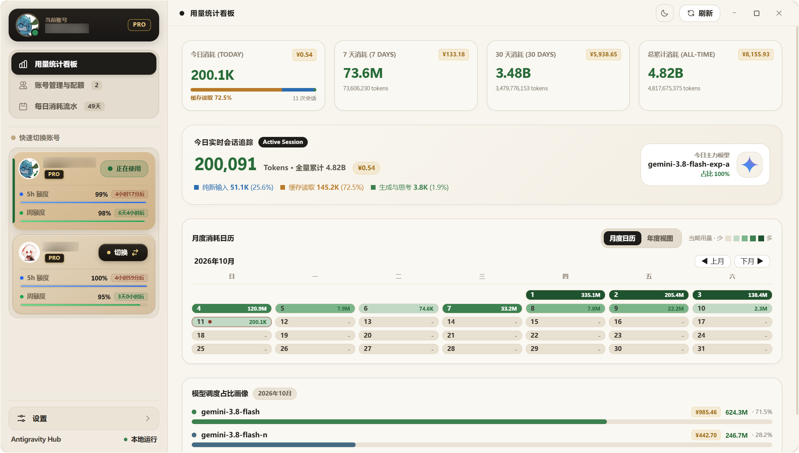
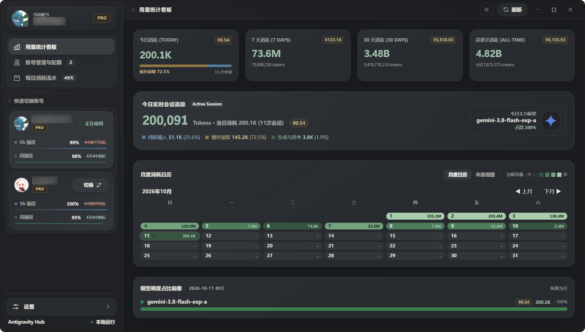
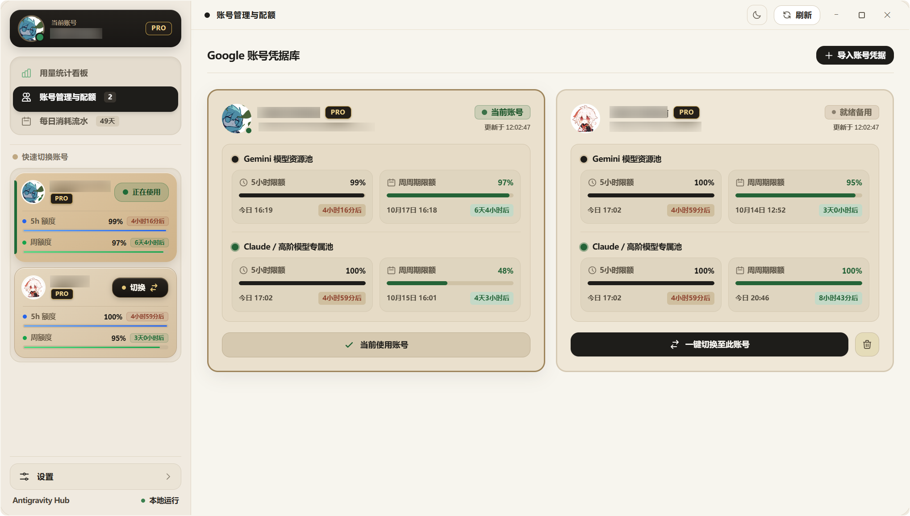
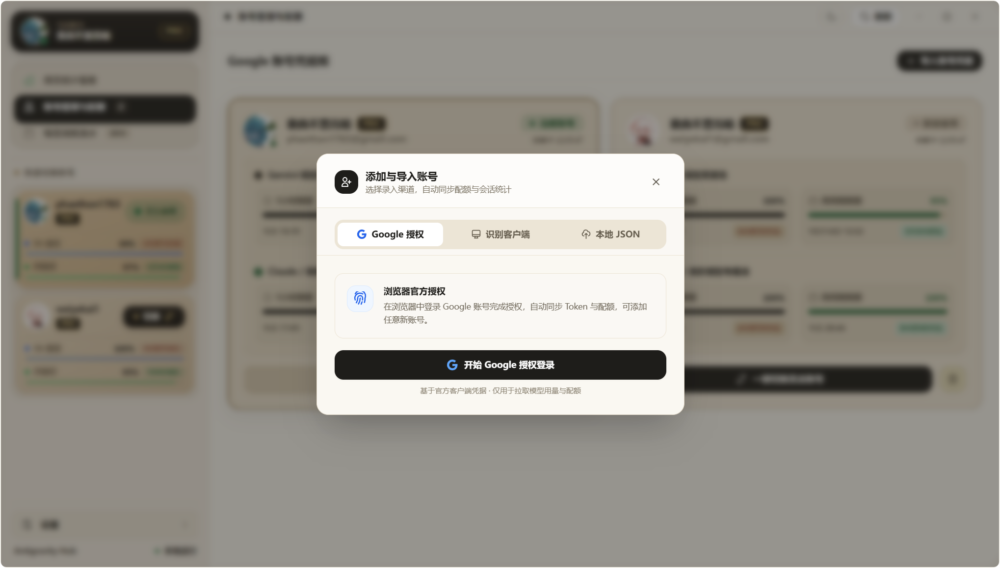
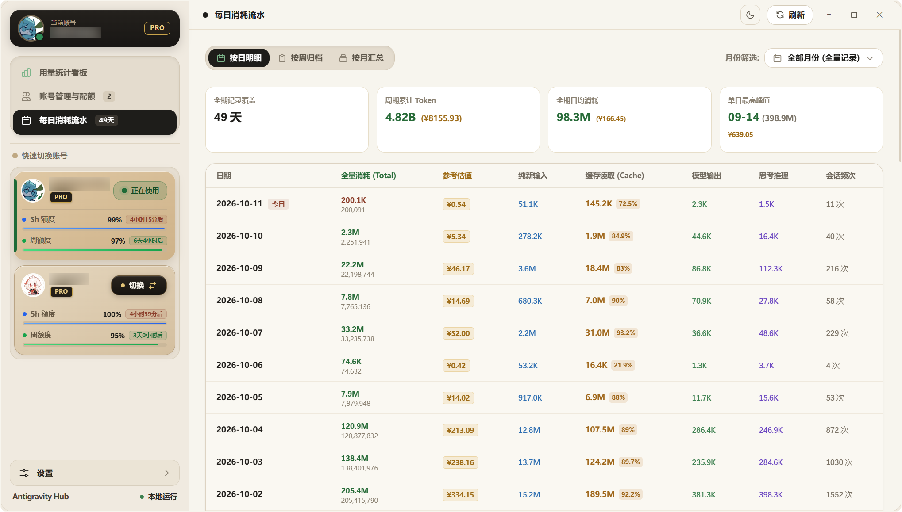
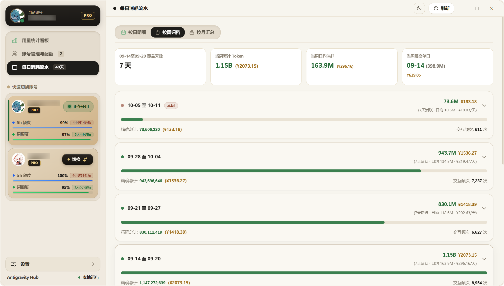
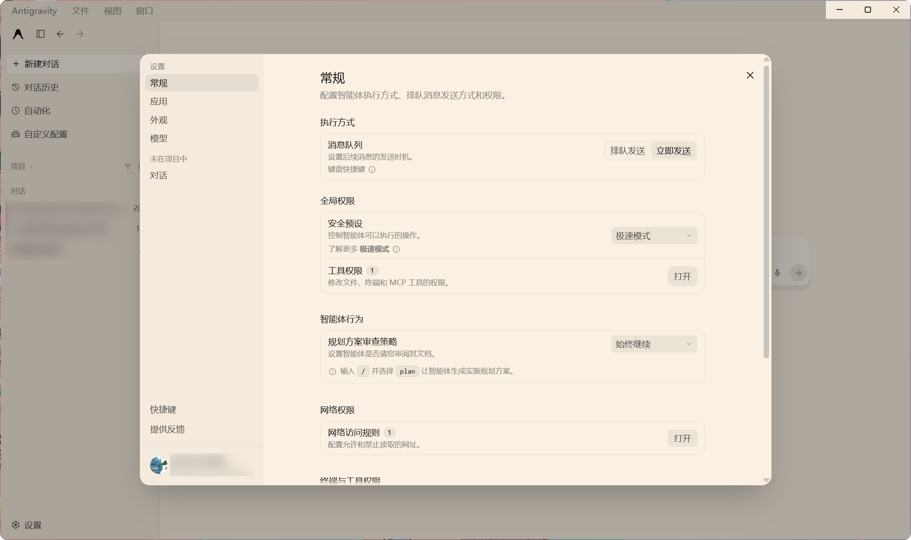
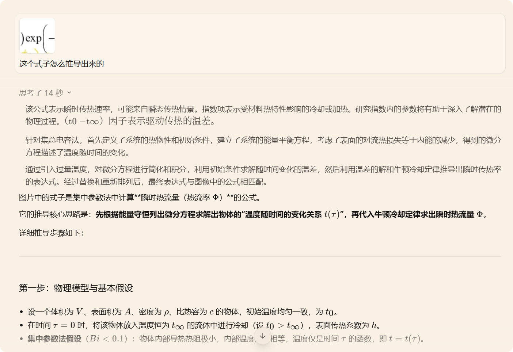
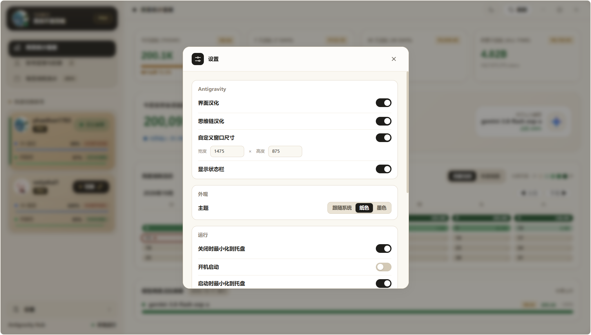
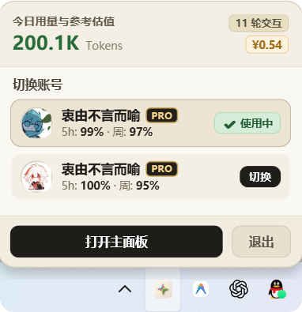

# AntigravityHub

Antigravity 辅助工具：把账号、配额、用量看板、客户端状态栏，以及界面与思维链汉化和窗口设置放进同一个 Hub。

[下载 Windows 版](https://github.com/Cainite07/AntigravityHub/releases/latest) · [版本说明](docs/RELEASE_NOTES_2.25.0.md) · [MIT 许可证](LICENSE)

**v2.25.0 · Windows x64 · 客户端增强适配 Antigravity 2.25.0（兼容 2.22.0 / 2.23.x / 2.24.0）**

版本号跟随客户端：适配 Antigravity 2.23.0 时，Hub 为 2.23.0；Hub 自身修复递增为 2.23.1、2.23.2，下一代客户端适配从 2.24.0 开始。


## 界面预览

<table>
  <tr>
    <td width="50%" align="center"><a href="docs/images/overview-light.png"></a><br><sub>纸色主页</sub></td>
    <td width="50%" align="center"><a href="docs/images/overview-dark.png"></a><br><sub>墨色主页</sub></td>
  </tr>
</table>

<p align="center">
  <a href="docs/images/client-status.png"></a><br>
  <sub>头像 · 5 小时额度 · 会话平均输出速率 · 今日 token</sub>
</p>

<details>
<summary>账号与用量</summary>

<table>
  <tr>
    <td width="50%" align="center"><a href="docs/images/accounts.png"></a><br><sub>账号管理</sub></td>
    <td width="50%" align="center"><a href="docs/images/account-import.png"></a><br><sub>导入账号</sub></td>
  </tr>
  <tr>
    <td width="50%" align="center"><a href="docs/images/usage-daily.png"></a><br><sub>每日消耗流水</sub></td>
    <td width="50%" align="center"><a href="docs/images/usage-weekly.png"></a><br><sub>按周归档流水</sub></td>
  </tr>
</table>

</details>

<details>
<summary>界面与思维链汉化</summary>

<table>
  <tr>
    <td width="50%" align="center"><a href="docs/images/client-localization.png"></a><br><sub>界面汉化</sub></td>
    <td width="50%" align="center"><a href="docs/images/thinking-localization.png"></a><br><sub>思维链汉化</sub></td>
  </tr>
</table>

</details>

<details>
<summary>设置与托盘</summary>

<table>
  <tr>
    <td width="50%" align="center"><a href="docs/images/settings.png"></a><br><sub>设置页面</sub></td>
    <td width="50%" align="center"><a href="docs/images/tray.png"></a><br><sub>托盘快捷切换</sub></td>
  </tr>
</table>

</details>


## 功能

- **账号管理**：读取当前客户端登录、导入与切换账号，查看订阅、Gemini／Claude 的 5 小时与每周额度，以及重置时间。
- **用量看板**：查看今日、7 天、30 天和累计用量，支持日／周／月明细、热力图、模型画像与参考费用。
- **客户端状态栏**：在输入栏旁查看头像、当前模型额度、会话平均输出速率和今日 token；展开后可切换备用账号或打开 Hub。
- **界面汉化**：只处理客户端界面文字，保留插件名称与介绍、技能、规则和聊天正文的原文。
- **思维链汉化**：与界面汉化分开控制，只翻译客户端已经展示的思考内容，两种汉化均默认关闭。
- **窗口设置**：可自定义客户端宽高；未启用时沿用原有窗口行为，启用后按当前显示器可用区域限制尺寸。
- **内置更新**：启动时检查 GitHub 正式版本，也可在设置中手动检查；点击更新后原位覆盖并重启，保留账号与设置。
- **外观与托盘**：纸色／墨色主题、跟随系统外观、托盘快捷切换和全局快捷键。

固定界面文字使用本地词典，部分动态提示及用户开启的思维链汉化会使用腾讯／有道翻译服务。

状态栏速率是**当前会话已完成请求的加权平均值**：有效正文输出 token 总量除以对应的流式生成总时长，不计首 token 等待与工具执行时间。约每 3 秒刷新；无有效记录时显示 `—`，切换会话时清空旧值。速率统计不上传会话内容。


## 快速开始

1. 从 [Releases](https://github.com/Cainite07/AntigravityHub/releases/latest) 下载 Windows x64 压缩包。
2. 完整解压后打开 `AntigravityHub.exe`。首次启动默认进入托盘，从托盘打开主界面。
3. 导入已有客户端账号，或按需使用 Google 授权、本地 JSON 导入。
4. 在设置页开启需要的汉化或调整窗口尺寸；需要重启时可点击提醒中的按钮。

需要 **Windows x64** 和 **Microsoft Edge WebView2 Runtime**。完整发布包已经包含 .NET、Node.js、Python 运行组件，无需另外安装。


## 使用与设置

汉化、窗口与状态栏组件已包含在发布包内，Hub 会自动校验并接入已支持的客户端。如果客户端正在运行，会等它正常退出后应用，不会强制结束任务。

界面汉化、思维链汉化和自定义窗口尺寸默认关闭，在设置页分别开启。窗口宽高初始值为 **1400×900** 逻辑像素；未启用自定义尺寸时不会锁定窗口。

关闭设置窗口即保存。修改汉化开关后，无论点击关闭、外部区域还是按 Esc 退出，都会在保存成功后显示重启提醒，也可以稍后重启。

首次使用默认开启「关闭时最小化到托盘」和「启动时最小化到托盘」，可在设置中调整；已有用户保存的选择保留。更多细节见 [使用与配置](docs/USAGE.md)。


更新检查默认开启，可在设置的「Hub 更新」中关闭。新版本提示支持稍后再更新；下载和校验完成后才退出 Hub，启动失败会尝试自动恢复旧版。更新文件只暂存在系统临时目录，完成后清理。旧版用户需先安装一次 **1.4.0**，以后即可使用内置更新。

## 账号与本地数据

授权登录与令牌刷新需要匹配 Antigravity 服务的本地 OAuth 配置，公开源码和发布包不包含客户端 ID／secret。已有有效令牌可直接读取；没有 OAuth 配置时仍可查看本地用量。配置方式见 [OAuth 本地配置](docs/USAGE.md#oauth-本地配置)。

账号、加密令牌、用量数据库和设置保存在 `%USERPROFILE%\.antigravity_hub`。用量金额按参考费率估算，并非实际订阅账单。

客户端增强目前仅适配 **Antigravity 2.22.0 Windows x64**。客户端升级后如不兼容，维护器会拒绝修改；已经打过旧补丁的客户端可能需要提供同版本原版包。接入与回退步骤见 [客户端增强说明](docs/CLIENT_ENHANCEMENTS.md)。


## 构建与验证

构建需要 .NET 10 SDK。生成完整发布包时会联网下载并校验固定版本的运行组件：

```powershell
dotnet build src/AntigravityHub -c Release
./Build-Release.ps1
```

单独使用 `dotnet publish` 只构建 Hub；完整发布包由 `Build-Release.ps1` 准备。前端样式重新生成、原版底包准备和项目结构见 [开发与维护](docs/DEVELOPMENT.md)。

运行默认隔离检查：

```powershell
./Test-AntigravityHub.ps1
```

检查覆盖账号持久化、设置、统计聚合、原生控件、汉化开关与客户端增强包。组合补丁检查需要本地原版底包和维护器依赖；默认检查不操作真实账号或客户端安装。

项目采用 [MIT 许可证](LICENSE)，第三方组件保留各自的许可证与署名，见 [第三方声明](THIRD-PARTY-NOTICES.md)。个人第三方辅助工具，与 Antigravity 官方无隶属关系。
